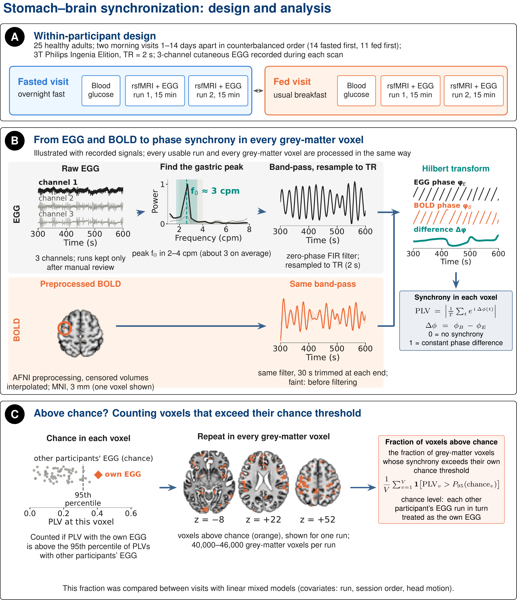
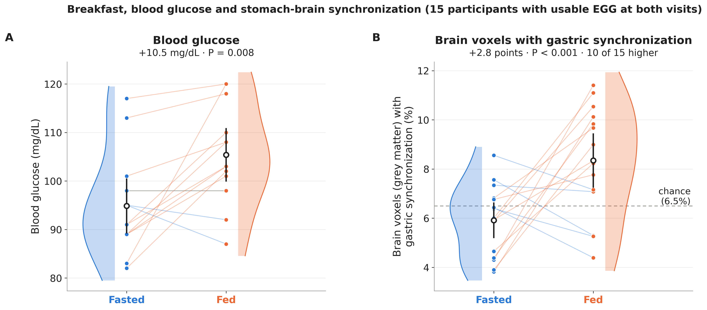

# GUT-BFF: stomach-brain phase synchrony in fed and fasted states


Analysis code for the Gut-Brain Fed/Fasted (GUT-BFF) study, which compares synchrony between the gastric rhythm,
recorded with electrogastrography (EGG), and resting-state BOLD fMRI after an overnight fast and after breakfast in
the same participants.

## Overview

- **Design:** 25 healthy adults, two morning visits in counterbalanced order (fasted, fed), each with two 15-min
  resting-state runs and concurrent three-channel EGG on a 3T Philips Ingenia Elition scanner.
- **Synchrony:** phase-locking value (PLV) and amplitude-weighted PLV (awPLV) between the EGG and BOLD signals,
  both band-passed around each run's EGG peak (about 0.05 Hz).
- **Chance level:** each run's BOLD signal paired with the EGG of every other participant.
- **Outcomes:** coupling strength (synchrony above chance in five predefined region sets) and prominence (the share
  of grey-matter voxels whose PLV exceeds the 95th percentile of their own chance distribution).
- **Statistics:** linear mixed models with run, session order and head motion, checked with participant
  fixed-effects models; FDR correction across regions and networks; permutation tests for whole-brain maps.

The data are not included in this repository.

## Repository layout

```
atlas/                      one subfolder per source atlas (files not included; see the README in each)
  schaefer2018/ tian2020/ harvard_oxford/ conn_networks/ rebollo2018/
figures/abstract/           Figures 1 and 2 of the abstract
src/
  config.py                 paths (set with environment variables)
  gutsync.py                filtering, Hilbert transform, PLV, model fitting
  01                        atlases and region sets
  02-04                     synchrony, EGG-head motion synchrony, primary models
  05-07                     whole-brain test, chance level of prominence, glucose and reliability
  08-11                     voxel maps, threshold-free score, estimated synchronized fraction
  12-13                     abstract figures
```

## Installation

```
git clone git@github.com:ismailukman/gut-brain-fed-fasted.git
cd gut-brain-fed-fasted
pip install -r requirements.txt
```

AFNI preprocessing (`afni_proc.py`) is run beforehand.
Figure 1 of the abstract (`13_figure1_methods.py`) also needs `tectonic` and `pdftoppm` (poppler), and the example
run it shows is read from the raw BIOPAC recording with `bioread`.

## Inputs

Place these in the project folder (`GUTBFF_BASE`, by default the repository folder):

| Path | Content |
|---|---|
| `data/gutbff_analysis_manifest.csv` | one row per run: participant, visit, state, run, EGG review result, analysis set, path to the preprocessed BOLD file (`bold_file`) and to the filtered EGG (`egg_filtered_file`) |
| `data/gutbff_runs.csv` | one row per run: session order, EGG peak frequency and quality, mean framewise displacement, censoring, glucose, path to the AFNI motion parameters (`motion_file`) |
| `data/gutbff_subjects.csv` | one row per participant: analysis set, session order, age, sex, BMI, glucose at each visit, days between visits |
| `atlas/<name>/` | source atlases for `01_build_atlas.py` (below) |

EGG and motion paths in the tables are relative to `GUTBFF_RAW`. Each filtered EGG (`gast_data_*.npy`, 10 Hz) is
stored with its filter frequency (`max_freq*.npy`) in the same folder.

| Folder and files | Source |
|---|---|
| `schaefer2018/`: `Schaefer2018_200Parcels_7Networks_order_FSLMNI152_1mm.nii.gz`, `Schaefer2018_200Parcels_7Networks_order.txt` | Schaefer et al. (2018), CBIG repository |
| `tian2020/`: `Tian_Subcortex_S1_3T_2009cAsym.nii.gz` | Tian et al. (2020), Melbourne Subcortex Atlas |
| `harvard_oxford/`: `atlas.nii` | Harvard-Oxford atlas as distributed with the CONN toolbox (insula labels 3 and 4) |
| `conn_networks/`: `networks.nii`, `networks.txt` | CONN toolbox network masks (32 ROIs, 8 networks) |
| `rebollo2018/`: `rebollo2018_gastric_network_mask.nii.gz` | Rebollo et al. (2018), NeuroVault image 51888 |

## Configuration

```
export GUTBFF_BASE=/path/to/project                # data/ and atlas/; results and figures are written here
export GUTBFF_RAW=/path/to/raw                     # start of the relative EGG and motion paths
export GUTBFF_GRID_REF=/path/to/one_errts.nii.gz   # defines the 3-mm analysis grid
export GUTBFF_TEMPLATE=/path/to/MNI152_2009_template.nii.gz   # background for the brain slices (Figure 1)
```

## Running

Run the scripts in `src/` in numerical order, for example `python src/02_synchrony.py`.

| Script | Purpose |
|---|---|
| `01_build_atlas.py` | Resample atlases to the BOLD grid; define the five region sets |
| `02_synchrony.py` | PLV and awPLV per region set, parcel and voxel, with the chance level (slow: reads every BOLD run) |
| `03_motion_egg.py` | Synchrony between the EGG and head motion, by state (a covariate in one sensitivity analysis) |
| `04_primary_and_localization.py` | Coupling strength and prominence models, sensitivity analyses, region sets, overlap with Rebollo et al. (2018) |
| `05_voxel_second_level.py` | Whole-brain voxel-wise sign-flip permutation test |
| `06_prominence_control.py` | Chance level of prominence from mismatched EGGs (slow) |
| `07_control_glucose_reliability.py` | Prominence control statistics, glucose models, reliability (ICC) |
| `08_voxel_maps_plv_awplv.py` | Voxel maps of PLV and awPLV minus the chance mean (slow) |
| `09_threshold_free_prominence.py` | Threshold-free score: mean share of chance values each voxel's PLV exceeds (slow) |
| `10_voxel_score_maps.py` | Voxel maps of the threshold-free score (slow) |
| `11_true_fraction.py` | Estimated fraction of synchronized voxels from the distribution of voxel scores (Storey's method) |
| `12_figures_abstract.py`, `13_figure1_methods.py` | Abstract Figures 2 and 1 |

Tables are written to `results/` (CSV) and figures to `figures/` (abstract figures to `figures/abstract/`). Each
figure is saved with and without its caption.

## Figures

**Figure 1.** Design and analysis. (A) Fasted and fed morning visits in counterbalanced order, each with a blood
glucose test and two 15-min resting-state fMRI runs with EGG. (B) The EGG is band-pass filtered at its gastric peak
(f0 ± 0.015 Hz), each grey-matter voxel's BOLD signal in the same band, and the phase-locking value (PLV) is computed
from Hilbert phases. (C) A voxel is synchronized when its PLV with the same-run EGG exceeds the 95th percentile of its
PLVs with other participants' EGG.



**Figure 2.** Fasted and fed visits in the 15 participants with usable EGG at both visits (28 fasted and 27 fed runs).
(A) Blood glucose in the 13 with values at both visits (Wilcoxon test). (B) Fraction of grey-matter voxels with gastric
synchronization; dashed line, chance (about 6.5%). Change and P from a linear mixed model using all runs. Points,
participant means; lines join each participant (orange, higher when fed; blue, lower; grey, unchanged); white
circles, mean and 95% CI.



## References

- Rebollo I, et al. Stomach-brain synchrony reveals a novel, delayed-connectivity resting-state network in humans. *eLife* 2018;7:e33321.
- Choe AS, et al. Phase-locking of resting-state brain networks with the gastric basal electrical rhythm. *PLoS One* 2021;16:e0244756.
- Levakov G, Ganor S, Avidan G. Reliability and validity of brain-gastric phase synchronization. *Hum Brain Mapp* 2023;44:4956-4966.
- Storey JD, Tibshirani R. Statistical significance for genomewide studies. *Proc Natl Acad Sci USA* 2003;100:9440-9445.
